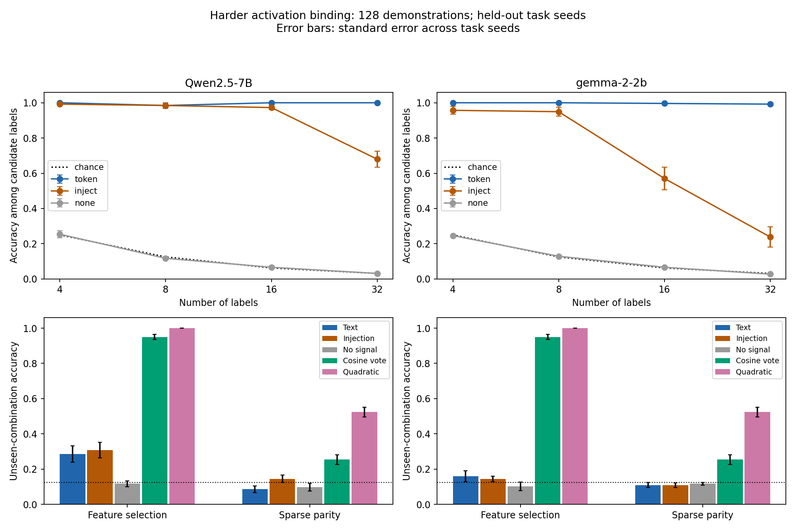

# Harder activation binding: first results

Completed September 16, 2026 (Pacific time). Frozen Gemma-2-2B and Qwen2.5-7B, evaluated on two dedicated A100 80GB GPUs in parallel. Both pods were terminated after verified local retrieval. Estimated GPU cost: $1.11, excluding storage; see `compute.json`.

**Finding:** the injected channel supports many more than two arbitrary labels, and the task stops saturating as label count increases. However, the compositional experiments do not establish performance beyond similarity retrieval. Feature selection generalizes weakly in Qwen, far below a clean-vector cosine baseline; parity remains near chance, including when its input bits are supplied as text.

## Design and evaluation

Each prompt contains 128 demonstrations followed by independent queries. Item and label words are single tokens; items are distinct and independent of the latent signal. No rule description is supplied. Model parameters remain frozen.

- **Codebook:** K orthogonal injected codes map to K arbitrary output labels. K = 4, 8, 16, 32. Every queried code appeared in the demonstrations, with different item words.
- **Feature selection:** eight hidden bits; three randomly selected coordinates determine one of eight labels, under a random label permutation.
- **Sparse parity:** three disjoint pairs among eight hidden bits determine three XOR outputs, then one of eight arbitrary labels.
- **Random lookup control:** labels are randomly assigned to all 256 input combinations, with balanced global class counts.

Feature tasks reserve 64 combinations entirely from demonstrations. Each seed has 32 queries from this heldout pool plus 32 queries from demonstrated combinations, evaluated separately. No query answer is placed in another query's context. Each input vector has unit norm; it is mapped through a random orthonormal basis and multiplied by beta times the median centered activation norm at demonstration item positions. Text conditions expose spaced bits, or one marker word per codebook symbol. No-signal conditions omit both forms of signal.

Development seeds 0–3 selected the injection dose from {0.25, 0.5, 1, 2}. Evaluation used untouched task seeds 100–107: **256 queries per condition and seen/unseen subset**. Each task seed randomizes rule, words, label mapping, combinations, and direction. Model layer choices were fixed from prior experiments: Gemma hidden state 8; Qwen hidden state 4. Dose selection used unseen-combination accuracy for feature tasks and ordinary codebook accuracy. The codebook-8 dose was reused unchanged for K = 4, 16, 32.

| Model | Codebook dose | Selection dose | Parity dose |
| --- | ---: | ---: | ---: |
| Gemma-2-2B | 2 | 2 | 2 |
| Qwen2.5-7B | 1 | 1 | 2 |

Random-control dose 2 was fixed from the parity setting, without tuning on random-control results. Selection manifests were saved before the main heldout evaluation began.

All accuracy tables below use the most likely candidate label, **not mean label probability**. Error bars are standard errors across eight task-seed means. Full-vocabulary accuracy and probability mass are also saved. Clean-vector baselines receive the exact hidden input vectors. Their temperature/ridge settings were selected on development seeds 0–7 and then evaluated on the same actual queries used by each model; the broader baseline sweep is not substituted for those matched comparisons.

## Multiclass binding: saturation is removed

| Labels | Chance | Gemma injection, accuracy ± SE | Qwen injection, accuracy ± SE |
| ---: | ---: | ---: | ---: |
| 4 | 25.0% | 95.7% ± 2.2% | 99.2% ± 0.5% |
| 8 | 12.5% | 94.9% ± 2.5% | 98.4% ± 1.6% |
| 16 | 6.25% | 57.0% ± 6.4% | 97.3% ± 1.1% |
| 32 | 3.125% | 23.8% ± 5.7% | 68.0% ± 4.6% |

Textual markers score 98.4–100% across these settings; the no-signal controls track chance. At 32 labels, full-vocabulary top-1 accuracy is 19.9% for Gemma and 66.4% for Qwen. Gemma's average label probability mass falls to 12.7% at K=32, so its 23.8% candidate-label accuracy should not be presented as unrestricted generation accuracy.

This establishes usable association capacity beyond a binary sign. It remains compatible with similarity-based lookup: nearest cosine on the clean codes is perfect. The decline at larger K is a limit under this specific budget and dose, not an intrinsic channel-capacity estimate. With 128 total demonstrations, examples per class decrease as K increases; no K-specific dose or layer search was performed.

## Unseen combinations: no advantage over retrieval

All tasks here have eight output labels, so nominal chance is 12.5%.

| Method | Feature selection | Sparse parity |
| --- | ---: | ---: |
| Gemma injection | 14.5% ± 1.6% | 10.9% ± 1.3% |
| Gemma text | 16.0% | 10.9% |
| Gemma no signal | 10.2% | 11.7% |
| Qwen injection | 30.9% ± 4.4% | 14.5% ± 2.1% |
| Qwen text | 28.5% | 8.6% |
| Qwen no signal | 11.7% | 9.8% |
| Clean-vector cosine voting | 94.9% | 25.4% |
| Clean-vector quadratic ridge | 100.0% | 52.3% |

Qwen's injected feature-selection score is above its no-signal score by 19.1 percentage points (paired task-seed bootstrap 95% interval: 12.9 to 26.2 points). Its 2.3-point advantage over explicit text is not resolved by these eight seeds (interval: -3.9 to 9.0 points). These intervals are exploratory and not corrected for multiple comparisons.

The parity scores do not provide persuasive evidence of the intended compositional rule learning. Qwen's injection improves over its unusually low no-signal and text controls, but its absolute 14.5% score remains near the 12.5% nominal chance level. Gemma remains at chance. Crucially, the textual representations also fail here; this experiment therefore cannot isolate a failure specific to the injected channel.

Feature selection was insufficient as a test against cosine matching: an aggregate of nearby exemplars solves almost all heldout queries. This is why the explicit competing baseline matters. None of the model results exceeds it.

## Random-label negative control

| Unseen random input combinations | Gemma | Qwen |
| --- | ---: | ---: |
| Injection | 12.1% ± 1.5% | 9.4% ± 0.8% |
| Text | 13.3% | 15.2% |
| No signal | 13.7% | 13.3% |

There is no generalization signal on the random mapping. This is consistent with the expected negative control. Seen-combination injection scores are also weak (13.3% Gemma, 19.5% Qwen), underscoring that these distributed eight-bit codes are more demanding than the small repeated codebooks.

## Interpretation and next experiment

The binary result was masking an interesting scaling curve: Qwen retains near-perfect association with sixteen injected symbols and remains substantially above chance with thirty-two. This is a useful setting for studying injection strength, geometry, examples per class, and interference.

The stronger claim—learning a compositional rule over novel combinations beyond similarity retrieval—is not established. Before expanding the injection sweep, the next experiment should find a compositional task and representation that these frozen models demonstrably solve from explicit text. A useful progression would hold the number of examples per class fixed for codebook scaling, then reduce the number of compositional features or add an explicit task description during a separately labeled textual feasibility phase. Only after textual performance is reliable should injection generalization become the decisive measurement. Exact circuit attribution would still require interventions on the model's computation.

## Validation and artifacts

- 23,040 main-model query evaluations: 7,680 development and 15,360 heldout/control evaluations.
- All expected file counts, seed IDs, query identities, probability bounds, normalization, and duplicate checks passed. Regenerated tasks match the stored queries and labels.
- Four source tests pass, covering task construction and cached query equivalence to independent full-prefix inference on a tiny random Qwen3 model, for both injected and uninjected evaluation. This is a software correctness test, not a checkpoint replication result.
- Rare tied bfloat16 logits break ties differently under vocabulary-index order and candidate-label order; full-vocabulary accuracy can consequently exceed candidate-label accuracy by a fraction of a percentage point. This does not change the conclusions.
- Model revisions and environment versions are in `results/{gemma,qwen}_environment.json`; source hashes are in `source_sha256.json`.
- `results/final_summary.json` contains seed-level metrics, matched baselines, and paired comparisons; its `.md` companion is the exhaustive table. `results/main_summary.png` summarizes the main experiment.
- Raw `*_development.jsonl`, `*_heldout.jsonl`, dose-selection manifests, and logs are retained locally. The smaller Qwen3-0.6B CPU pilots are separate development artifacts and are excluded from all tables in this report.
- `README.md` documents tasks, commands, and limitations. `compute.json` records the two dedicated pods and confirmed cleanup.

Only the new `binding_v2` experiment was implemented. Existing binding results, grid-walk experiments, other running pods, and Markov-graft work were not modified.
