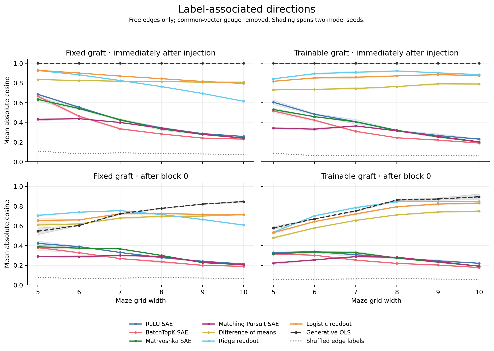
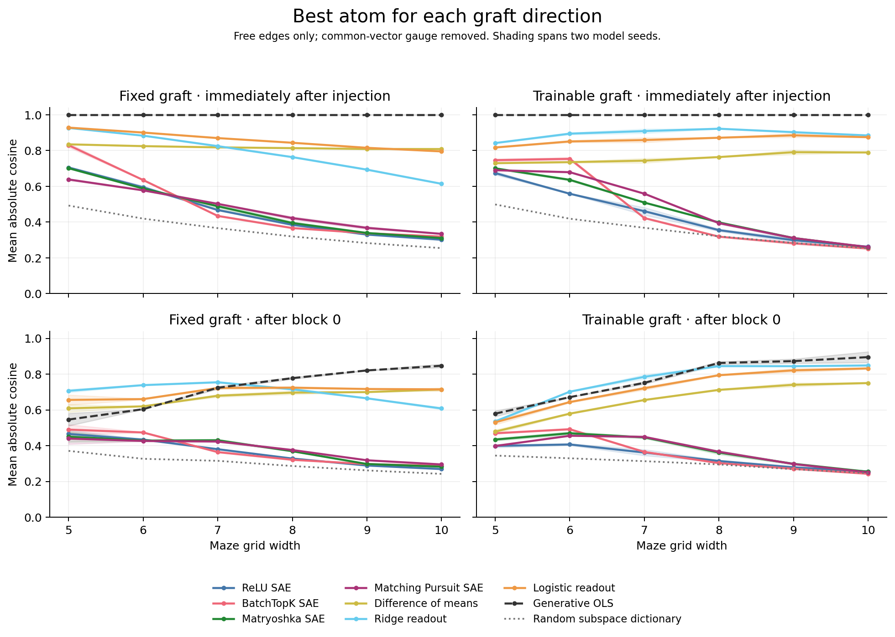
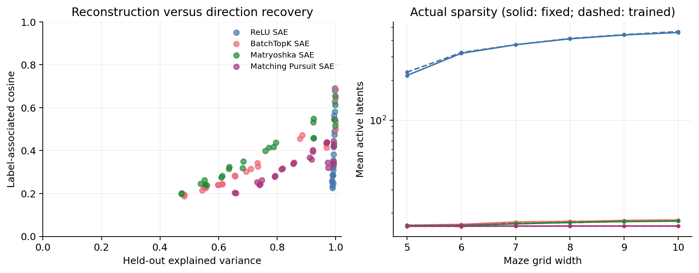
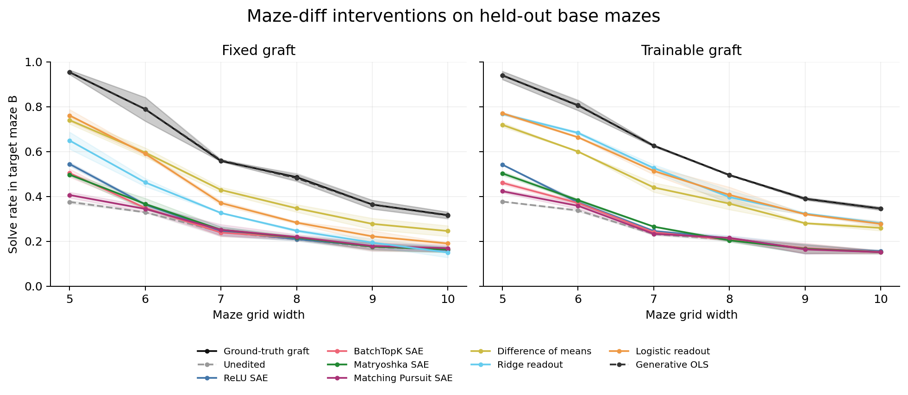
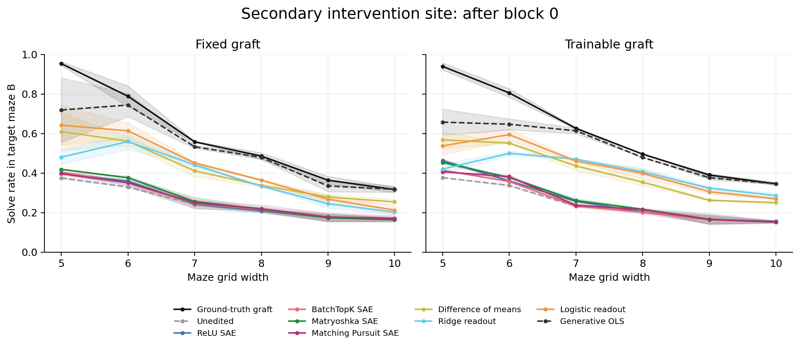
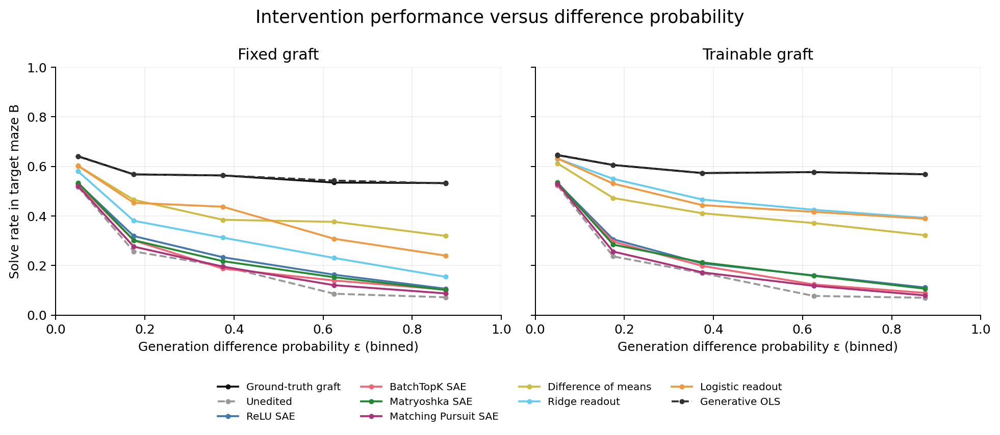
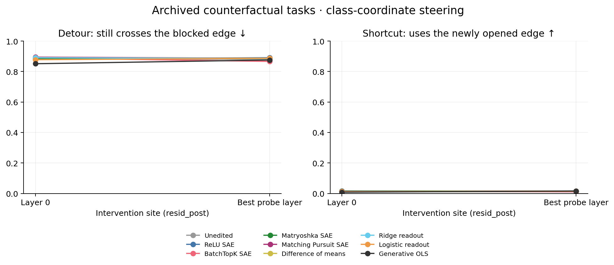
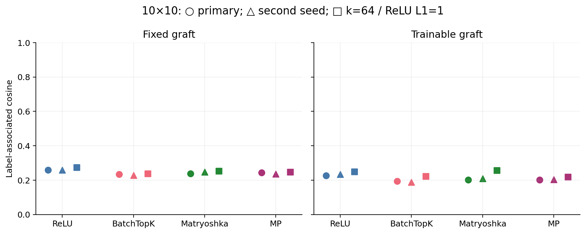

# Recovering known graft directions in maze transformers

The main result is that the tested SAEs reconstruct useful activation structure but do not reliably isolate the individual graft directions across maze sizes. Supervised readout directions align much better, and generative linear regression recovers the identifiable graft directions almost exactly. These are results for a fast, explicitly specified training budget, not a fully tuned ranking of SAE architectures.

**Coverage.** Six grid sizes (5–10), two model seeds, fixed and trainable grafts: 24 grafted checkpoints. Each is analyzed immediately after the layer-0 graft at PATH_START and after block 0. Additional experiments use two grid-6 baseline checkpoints, the archived counterfactual corpus, and a grid-10 SAE sensitivity study. All final outputs are under this directory; input checkpoint hashes are in `input_manifest.json`.

**The quantity being recovered.** The graft writes signed edge features through rows of `W_inj`. At PATH_START immediately after injection, the token/position embedding is constant within a grid, making the activations an exact linear mixture of edge features. Every DFS tree has exactly n²−1 open edges, so adding a common vector to all free-edge directions changes only the intercept. The primary target therefore subtracts the mean free-edge direction. Forced boundary edges are excluded. Raw-direction metrics are also saved. Post-block-0 comparisons measure alignment with the original graft directions in residual coordinates; they are not comparisons against a separately identified nonlinear transport of those directions.

**Primary direction recovery.** Each edge is associated with the SAE atom having the largest absolute validation correlation, without consulting the graft directions; multiple edges may select the same atom. Inactive atoms are excluded from best-atom geometric scores. The table gives mean absolute cosine for these label-associated directions, averaged equally across the 12 model/grid combinations per graft condition. Standard readouts retain their edge labels. Generative OLS predicts activations from edge labels, whereas the ridge/logistic probes predict edges from activations; generative OLS is a supervised writing-direction control, not a conventional readout probe.

| Method | Fixed graft | Trainable graft |
| --- | --- | --- |
| ReLU SAE | 0.425 | 0.384 |
| BatchTopK SAE | 0.369 | 0.317 |
| Matryoshka BatchTopK | 0.409 | 0.361 |
| Matching Pursuit SAE | 0.355 | 0.302 |
| Difference of means | 0.818 | 0.759 |
| Ridge readout | 0.784 | 0.893 |
| Logistic readout | 0.859 | 0.860 |
| Generative OLS (positive control) | 1.000 | 1.000 |

Unlabelled best-atom cosine, one-to-one assignment, the fraction of graft features with an atom above cosine 0.8, raw-column alignment, and per-edge scores are retained in the method JSON files and `direction_metrics.csv`. Best-of-dictionary comparisons include equally sized random dictionaries in the label-predictable activation subspace, plus ambient random dictionaries; labelled scores include shuffled-edge controls. A best atom need not be the atom whose activations identify the right edge. A discriminative readout is also a dual direction rather than a writing direction: accurate edge prediction does not by itself imply equality with a graft column.

**Reconstruction and sparsity.** A 1,024-atom dictionary is trained for 2,000 Adam steps of 512 examples, on 16,000 fitting mazes with 4,000 separate validation mazes. BatchTopK and Matryoshka use k=16, with calibrated threshold inference; Matching Pursuit unrolls 16 residual-greedy selections. ReLU uses L1=0.1. The compact implementations omit auxiliary dead-latent losses and extensive tuning. Measured sparsity differs substantially, so reconstruction alone does not support an architecture ranking.

| SAE | Explained variance | Active latents | Best-atom cosine | Label-associated cosine |
| --- | --- | --- | --- | --- |
| ReLU SAE | 0.993 | 371.2 | 0.450 | 0.405 |
| BatchTopK SAE | 0.728 | 17.0 | 0.475 | 0.343 |
| Matryoshka BatchTopK | 0.742 | 16.8 | 0.470 | 0.385 |
| Matching Pursuit SAE | 0.864 | 16.0 | 0.478 | 0.329 |

**Maze-diff interventions.** The prompt and original channel describe maze A. The intervention adds the recovered edge-direction change for B−A from ADJLIST_END onward, including decoding. Per-edge amplitudes are fitted from training activations, and global strength is selected from 0.5, 1, 2 on 20 validation base mazes. Test evaluation uses 60 disjoint base mazes per grid at distance levels 0, 1, 4, 8, 12 and independent-maze level 13, with all variants of a base maze kept together. The original graft replacement uses its trained strength (1). Rows below are paired solve-rate differences against that original graft at the injection site, in percentage points. Intervals bootstrap base mazes within each grid, jointly across the two model seeds and conditional on these checkpoints; they are not population confidence intervals over training seeds.

| Method | Fixed: Δ [95% interval] | Trainable: Δ [95% interval] |
| --- | --- | --- |
| ReLU SAE | -29.4 [-31.0, -27.8] | -31.7 [-33.5, -29.9] |
| BatchTopK SAE | -30.3 [-31.9, -28.7] | -33.4 [-35.2, -31.6] |
| Matryoshka BatchTopK | -29.9 [-31.5, -28.4] | -32.2 [-33.8, -30.3] |
| Matching Pursuit SAE | -31.6 [-33.3, -30.0] | -34.3 [-36.0, -32.5] |
| Difference of means | -13.9 [-15.1, -12.6] | -15.6 [-17.0, -14.2] |
| Ridge readout | -24.0 [-25.3, -22.6] | -10.4 [-11.7, -9.1] |
| Logistic readout | -17.5 [-18.8, -16.1] | -10.8 [-12.1, -9.6] |
| Generative OLS (positive control) | -0.0 [-0.2, +0.1] | -0.0 [-0.1, +0.1] |

Here ε is the biased-DFS generation probability, not the realized fraction of changed edges. The corpus was sampled by target Hamming-distance buckets, so the ε plot is a descriptive view of that corpus, not a controlled sweep sampled uniformly in ε. Per-pair ε and normalized edge difference are saved in `intervention_trials.csv.gz`. The rollout limit is 2n²+4 tokens, consistently applied within this experiment. The fitted injection-site generative coefficients agree with the mean-centered graft to a maximum relative error of 1.12×10⁻⁷ (`generative_control_precision.json`). Differences between generative OLS and the original graft can arise from numerical precision and strength selection; they should not be interpreted as discovery of better ground-truth directions. A win after block 0 would additionally change the intervention site.

Across both tested sites, the largest observed SAE-minus-graft difference was **-11.67 percentage points** (g10-s0-fixed, post0, Matching Pursuit SAE). This is an exploratory maximum over many comparisons, not a corrected significance claim.

The largest observed difference across **all** interpretation methods was +0.56 percentage points (g7-s0-trainable, post0, Generative OLS (positive control)). Small positive values in the generative control should be read in light of the numerical/strength caveat above.

Individual-maze wins do occur despite the aggregate losses. At the injection site, ReLU solves 55 of 8,632 test cases that the original graft misses, while missing 2,694 cases that the graft solves. The four SAEs each have 50–56 such individual wins at this site. `sae_paired_wins.csv` records wins and losses for both sites; these cases do not imply improved aggregate accuracy.

**Archived probe-steering replication.** The archived asset contains 4,522 edits over 600 tokenized mazes. We use current grid-6 baseline checkpoints, 8,000 fitting and 2,000 validation mazes, sweep probe accuracy across all 12 layers, and test layer 0 plus each model’s best logistic-probe layer. The original class-coordinate projection protocol is applied at every active position, with strength selected from 1, 4, 8 on 30 validation base mazes and evaluated on 100 held-out base mazes (750 edits). This reproduces the protocol and qualitative finding, rather than claiming numerically identical results from the historical checkpoints.

| Method at best probe layer | Still crosses blocked edge ↓ | Uses newly opened edge ↑ |
| --- | --- | --- |
| Unedited | 88.2% | 1.1% |
| ReLU SAE | 89.1% | 1.6% |
| BatchTopK SAE | 86.7% | 1.6% |
| Matryoshka BatchTopK | 88.5% | 1.4% |
| Matching Pursuit SAE | 88.7% | 1.1% |
| Difference of means | 88.7% | 1.6% |
| Ridge readout | 88.5% | 1.4% |
| Logistic readout | 88.7% | 1.4% |
| Generative OLS (positive control) | 87.6% | 1.6% |

**Sensitivity and limits.** At grid 10, a second SAE seed and increased sparsity budget (k=64, or ReLU L1=1) test whether the result is an obvious artifact of one initialization or the primary sparsity setting. Reconstruction can improve substantially without comparable improvement in directional alignment. Results are saved separately in `robustness_summary.csv`; these settings were not selected by optimizing the reported primary ground-truth cosine. Two model seeds, one dictionary width, two intervention sites and a limited training budget restrict generalization. The experiments do not establish that a fully optimized SAE, a multi-atom intervention, or another feature-distribution design cannot recover the graft.

**Verification and data separation.** The small numerical pilot checked the fast decoder against the model’s own forward pass. A separate 12-token comparison on four prompts for each of a fixed-graft, trainable-graft and baseline model exactly matched the existing reference KV decoder. Zero-strength archived interventions also matched across the two tested layers. Unit tests check the batch sparsity budget, Matching Pursuit’s monotonic reconstruction, finite gradients for all four SAEs, and the constant-sum identifiability correction. Exact connectivity auditing found overlap in the initial small-grid datasets; grids 5 and 6 were rerun with all fitting graphs deduplicated and excluded from every frozen A/B evaluation graph. Discarded outputs are isolated under `initial_overlap_runs/`. Final split and output-completeness checks are saved in `validation.json`. Each completed pod’s downloaded files are SHA-256 verified before termination.

**Artifacts and reproduction.** `experiment.py` runs the graft study; `methods.py` implements the SAEs/probes; `legacy.py` runs archived steering; `robustness.py` runs sensitivity checks; `figures.py` regenerates PNG/SVG figures; `subspace_nulls.py` computes the stronger dictionary null. `README.md` records the detailed protocol and sources. The implementation references are [dictionary_learning](https://github.com/saprmarks/dictionary_learning) for ReLU/BatchTopK/Matryoshka and [overcomplete MpSAE](https://github.com/KempnerInstitute/overcomplete/blob/main/overcomplete/sae/mp_sae.py) for residual-greedy Matching Pursuit.

**Compute.** 11 campaign pods have verified downloads and recorded termination. Estimated GPU runtime cost: $6.18, using the quoted hourly rates and observed rental durations; this is not a billing statement. Other concurrently running RunPod projects are outside this campaign.
